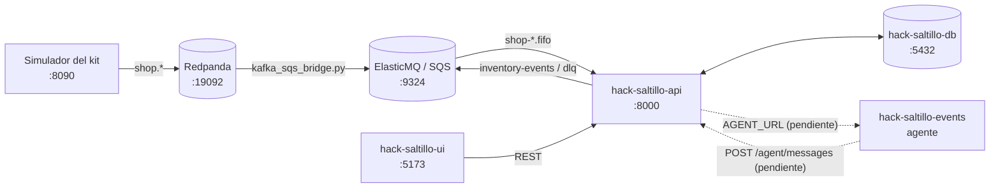

# hack-saltillo-events

Prototipo del **agente de inventario inteligente** de **Roceel** (reto *Almacén inteligente para taller*,
HackITS 2026). Es un proceso de consola en Node.js + TypeScript (paquete `agente`) que:

1. Lee un flujo de eventos de [`data/events.jsonl`](data/events.jsonl).
2. Valida cada evento con JSON Schema (AJV).
3. Lleva un inventario en memoria: piezas, ubicaciones y existencias.
4. Usa **Google Gemini** (`@google/genai`, modelo `gemini-3.8-flash`) para dos cosas:
   - analizar las notas de una inspección y recomendar **REPARAR** o **REEMPLAZAR** la pieza, con una
     justificación de una línea;
   - responder preguntas sobre el estado del inventario, en texto plano para la UI.
5. Cada 10 minutos (una hora simulada del taller) corre una auditoría de existencias.

**Estado:** prototipo independiente. Todavía no lee las colas SQS ni la base de datos, no llama a la API y no
expone un servidor HTTP. Cómo se conectará está en [Conectar con los demás repos](#conectar-con-los-demás-repos).

## Contenido

1. [El sistema completo](#el-sistema-completo)
2. [Correr en local](#correr-en-local)
3. [Formato de los eventos](#formato-de-los-eventos)
4. [Conectar con los demás repos](#conectar-con-los-demás-repos)
5. [Estructura](#estructura)
6. [Limitaciones conocidas](#limitaciones-conocidas)

## El sistema completo

| Repo | Qué hace | En local |
|---|---|---|
| [`hack-saltillo-db`](https://github.com/AgustinReyesC/hack-saltillo-db) | PostgreSQL 16: esquema, migraciones (Liquibase) y catálogo semilla. | `localhost:5432` |
| [`hack-saltillo-broker`](https://github.com/AgustinReyesC/hack-saltillo-broker) | Colas SQS FIFO: Terraform para AWS y ElasticMQ para local. | `localhost:9324` |
| [`hack-saltillo-api`](https://github.com/AgustinReyesC/hack-saltillo-api) | Servicio de inventario (NestJS): consume las colas, lleva el libro mayor, publica `stock.*` y expone REST y WebSocket. | `localhost:8000` (HTTP), `:8443` (HTTPS) |
| [`hack-saltillo-ui`](https://github.com/AgustinReyesC/hack-saltillo-ui) | Pantallas (React + Vite): dashboard, piso con escaneo, órdenes y resolución. | `localhost:5173` |
| **`hack-saltillo-events`** (este) | Prototipo del agente de IA (Gemini). Aún no se conecta a la API. | proceso de consola |
| `hackathon-inventario-kit` | Kit del reto (no es repo del equipo): Redpanda, simulador, contrato y pruebas de contrato. | `:19092` Kafka, `:8080` consola, `:8090` simulador |



El orden para levantar el resto del sistema está en el
[README de la API](https://github.com/AgustinReyesC/hack-saltillo-api#levantar-todo-el-sistema-en-local). Este
repo hoy corre por su cuenta y no depende de los demás.

## Correr en local

### Requisitos

- Node.js 20 o superior y npm.
- Una API key de Gemini ([Google AI Studio](https://aistudio.google.com/apikey)).

### Pasos

1. **Instalar dependencias:**

   ```bash
   npm install
   ```

2. **Configurar la llave de Gemini** en un archivo `.env` en la raíz del repo. El agente acepta
   `GEMINI_API_KEY` o `GOOGLE_API_KEY`:

   ```dotenv
   GEMINI_API_KEY=<tu-llave>
   ```

   `.env` lleva un secreto: no lo subas al repositorio.

3. **Compilar y correr:**

   ```bash
   npm run dev
   ```

| Script | Qué hace |
|---|---|
| `npm run build` | Compila `src/` a `dist/` con `tsc`. |
| `npm start` | Corre `dist/index.js` (requiere `npm run build`). |
| `npm run dev` | `build` + `start`. |

### Qué hace al arrancar

1. Carga los esquemas de validación de `part.upserted` y `location.upserted`.
2. Lee `data/events.jsonl` línea por línea, valida cada evento y lo aplica al inventario en memoria. Las
   inspecciones con notas se mandan a Gemini para el análisis de defecto.
3. Imprime un resumen del inventario (piezas, ubicaciones y existencias).
4. Le hace una pregunta de auditoría al asistente de IA e imprime la respuesta.
5. Arranca la auditoría periódica: imprime el resumen al inicio y cada 10 minutos. El proceso sigue vivo hasta
   que lo detienes con `Ctrl+C`.

Sin llave de Gemini el agente corre igual, pero las respuestas de IA salen como `Error en el análisis de IA.` /
`Error al consultar el asistente de IA.`

## Formato de los eventos

`data/events.jsonl` trae 4 eventos de ejemplo, uno por línea, en un formato propio (camelCase, con
`eventType` y `payload`). **No es** el sobre del contrato del kit (`event_type`, `data`, snake_case), así que hoy
el agente no puede leer el dataset del kit ni lo que publica la API.

```json
{"eventId": "evt-004", "eventType": "purchase.item_received", "timestamp": "2026-10-09T11:00:00Z", "payload": {"purchaseOrderId": "po-500", "itemId": "item-01", "partId": "p-101", "locationId": "loc-A1", "quantityReceived": 200, "receivedBy": "user-23"}}
```

| `eventType` | Qué hace el agente |
|---|---|
| `part.upserted` | Registra o actualiza la pieza (`partId`, `sku`, `name`, `unitOfMeasure`). |
| `location.upserted` | Registra o actualiza la ubicación (`locationId`, `name`, `type`, `active`). |
| `purchase.item_received` | Suma `quantityReceived` a la existencia de `partId` en `locationId`. |
| `inspection.submitted` | Registra la inspección; si trae `notes`, pide a Gemini la recomendación REPARAR / REEMPLAZAR. |
| cualquier otro | Lo registra en la consola sin aplicar reglas. |

## Conectar con los demás repos

La integración con la API ya está definida del lado de la API, pero este repo todavía no la implementa. Lo que
falta para conectarlo:

| Dirección | Cómo | Configuración |
|---|---|---|
| API → agente | La API reenvía cada evento de la cola `inventory-broker-notifications.fifo` con `POST {AGENT_URL}` y el sobre del evento como cuerpo (timeout de 5 s). El agente debe exponer esa ruta. | `AGENT_URL` en el `.env.local` de la API, por ejemplo `http://localhost:8100/events`. |
| Agente → API | El agente entrega su respuesta con `POST http://localhost:8000/agent/messages` y cuerpo `{"message": "...", "data": {...}}` (`data` opcional). La API responde 202 y lo manda a la UI por WebSocket (`agent:message`). | URL de la API en el agente. |
| Agente → API (consultas) | REST de la API: `GET /parts`, `GET /parts/{id}/availability`, `GET /parts/{id}/ledger`, `GET /part-instances`, `GET /shortages`, `GET /reorder-suggestions`, `GET /work-orders/{code}/materials`, `GET /suppliers`. | Sin CORS: el agente llama desde servidor. |
| UI → chat | El chat de la UI manda `POST {VITE_CHAT_URL}/chat` con `{"message"}` y espera `{"answer"}`. La UI apunta por defecto a `http://localhost:8100`. | `VITE_CHAT_URL` en el `.env.local` de la UI. |

Para decidir cuándo comprar, el diseño de la API
([`docs/API Design.md`](https://github.com/AgustinReyesC/hack-saltillo-api/blob/main/docs/API%20Design.md))
propone que el agente lea, cada hora simulada, la existencia (`v_part_availability`), los faltantes
(`v_open_shortages`), mínimos y lead time (`reorder_policy`), sugerencias (`reorder_suggestion`), el precio
histórico (`purchase_line.unit_price`) y la fecha de entrega (`purchase_order.expected_at`). Todo eso se consulta
por la API, no directo en la base.

Una vez implementado, en local quedaría así: el agente escucha en un puerto propio (la UI ya espera el `8100`),
la API corre con `AGENT_URL` apuntando a él, y la UI con `VITE_CHAT_URL` apuntando al servicio que atienda
`/chat`.

## Estructura

```text
src/
  index.ts                         Arranque: esquemas, consumo del archivo, resumen, consulta de IA y scheduler
  services/
    event-consumer.service.ts      Lee el JSONL línea por línea y valida cada evento
    validator.service.ts           AJV + ajv-formats
    inventory.service.ts           Inventario en memoria y reglas por tipo de evento
    ai.service.ts                  Cliente de Gemini: análisis de defecto y asistente de inventario
    scheduler.service.ts           Auditoría periódica (cada 10 min)
  models/                          Tipos de eventos de entrada, salida e inventario
  schemas/                         JSON Schema de part.upserted y location.upserted
data/events.jsonl                  Eventos de ejemplo
```

## Limitaciones conocidas

- **Esquemas:** `src/index.ts` busca los esquemas en `schemas/` en la raíz del repo, pero están en
  `src/schemas/`. Al arrancar avisa `Archivo de esquema no encontrado` y deja pasar todos los eventos sin validar.
- **Formato:** los eventos no siguen el contrato del kit (ver [Formato de los eventos](#formato-de-los-eventos)).
- **Consulta de auditoría:** la pregunta al asistente usa un resumen de texto fijo, no el estado real del
  inventario.
- **Persistencia:** el inventario vive en memoria y se pierde al detener el proceso.
